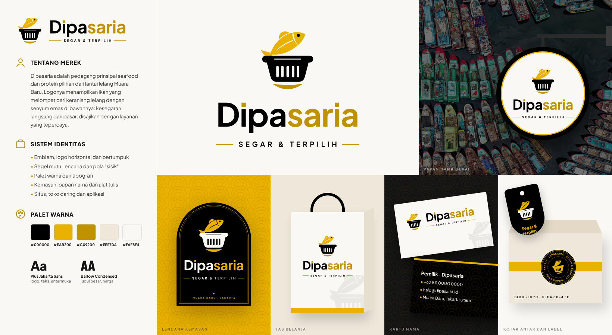

# Dipasaria brand guidelines

How the brand looks, sounds and reads. These rules apply to the website, the storefront, the admin panel, WhatsApp messages, packaging labels and anything printed. Where this document and the code disagree, the code is the source of truth for colours and type; update this document when you change them.

## 1. Positioning in one line

**Dipasaria: protein pilihan for Jakarta's kitchens.** A principal trader on the Muara Baru auction floor: we buy before we sell, so we stand behind the species, size, weight and temperature of everything we deliver.

Four things the brand must communicate, in this order:

1. **Freshness**: bought at the 03.00 auction, delivered cold the next morning, nothing held overnight.
2. **Honesty**: every fish is named by species (Indonesian, English, scientific) and size; weighed after preparation.
3. **Reliability**: order by 20.00, delivered in the slot you chose, the same standard every day.
4. **Trust**: halal documents per lot, a recorded cold chain, a 2-hour replacement or refund guarantee.

Premium here means *precise and calm*, not luxurious. We earn it with clear facts, real photography and restraint, never with superlatives.

## 2. Logo

### The emblem

A snapper leaping out of a market basket, with a gold arc beneath.

- **The basket (keranjang)** is the auction crate at Muara Baru, and the "pasar" in Di*pasar*ia: we are traders who buy at the market so you don't have to.
- **The leaping fish** is freshness: just landed, still moving. A curved body, tapered gill, fine lateral line and single eye make it unmistakably a snapper.
- **The gold crescent (senyum)** tapers to fine points: both the sea and the smile of good service, reliability and trust.
- **Craft details:** five slim slots and a fine line inside the rim. At 32 px and below the small version (`<Emblem small />`, favicon, seal) drops the lateral and rim lines and uses four slots so it stays crisp.

Built on a 120 × 123 grid. Geometry lives in `scripts/brand/build.cjs` and is generated into `src/components/brand/paths.ts`; never redraw it by hand.

### Wordmark and tagline

- **Wordmark:** "Dipasaria" in Plus Jakarta Sans Bold (700), mixed case, tracking −1.6%, converted to outlines. Two tones: **Dipa** in black (cream on dark) and **saria** in deep gold `#C09200` (gold `#EAB200` on dark). The square dot of the "i" in Dipa is set in gold: the one accent that ties the two halves together.
- **Tagline:** "— SEGAR & TERPILIH —" in Plus Jakarta Sans Bold, uppercase, tracking 0.34 em, between two gold rules.

### Lockups

| Lockup | Use | Component / file |
| --- | --- | --- |
| Horizontal | Header, admin, invoices, email | `<Logo />` · `logo-horizontal.svg` |
| Horizontal with tagline | Footer, documents, social image | `<Logo tagline />` · `logo-horizontal-tagline.svg` |
| Stacked with tagline | Signage, bags, packaging, offline page, hero moments | `<Logo stacked tagline />` · `logo-stacked.svg` |
| Emblem | Avatars, stickers, small spaces | `<Emblem />` · `emblem.svg` |
| App tile | App icon, favicon | `<LogoMark />` · `icons/icon.svg` |
| Seal "DIPASARIA · SEGAR & TERPILIH · MUARA BARU · JAKARTA" | Quality stamp on packaging, hero, footer | `<Seal />` · `seal.svg`, `seal-black.svg` |
| Arch badge | Premium plaque for packaging lids, signage, the story page | `badge-arch.svg` |

Add `dark` to any component for black backgrounds.

### Colour versions

- **Full colour on cream or white:** black basket, gold fish, deep-gold arc, black and deep-gold wordmark. Primary.
- **Reversed on black:** cream basket, gold fish and arc, cream and gold wordmark.
- **One colour:** all black (or all cream on black) for stamps, embossing, fax and newsprint; the eye becomes a cut-out.

### Do not

- Recolour outside the palette, add gradients, outlines or shadows.
- Separate the fish from the basket, or flip the fish to face left.
- Retype the wordmark in a live font, change its two-tone split, or set it in capitals.
- Place full colour on gold (use one-colour black) or on busy photography without a dark overlay.

Clear space: the height of the basket rim on every side. Minimum size: emblem 20 px, horizontal lockup 32 px tall, stacked lockup 96 px tall.

### Files and regeneration

`public/brand/`: emblem (colour, reversed, black, cream), horizontal and stacked lockups (SVG and PNG), seals, `pattern-sisik.svg` (gold) and `pattern-sisik-ink.svg` (black). `public/icons/`: app and touch icons. `public/og.jpg`: social preview. `docs/brand/brand-board.png`: presentation board.
Regenerate everything with `npm run brand`.

### Graphic element: "sisik"

Overlapping scale arcs that read as both fish scales and waves. Use it at 6–14% opacity on black and gold surfaces (footer, gold strips, dark bands, packaging, the back of business cards) via `<Sisik />`. Never on photography or behind body text on light backgrounds.

## 3. Colour

| Token | Hex | Role |
| --- | --- | --- |
| Black (`ocean-950`) | `#000000` | Header, footer, primary buttons, dark bands |
| Gold (`coral-500`) | `#EAB200` | Accent buttons, cut-off strip, highlights on black |
| Deep gold (`coral-600`) | `#C09200` | Hover, member strip, pressed states |
| Gold ink (`gold-ink`) | `#866500` | Small gold text on light backgrounds (eyebrows, links). Passes WCAG AA; `#EAB200` and `#C09200` do not on cream |
| Cream (`sand-50`) | `#FAF8F4` | Default page background |
| Parchment (`sand-100`) | `#EEE7DA` | Alternate bands, cards on cream |
| Ink | `#121212` | Body text |
| Mute | `#5C5C5C` | Secondary text |
| Line | `#E2DCCF` | Borders and dividers |

Proportions: roughly 60% cream and parchment, 30% black, 10% gold. Gold is the signal colour: if everything is gold, nothing is. Success green and warning amber are for status badges only.

## 4. Typography

- **Brand sans: Plus Jakarta Sans** (400 to 800). The logotype is drawn from it, and it sets all body text, forms, labels, buttons and the tagline. It was designed for Jakarta's own city identity, which suits a Jakarta brand.
- **Display: Barlow Condensed** (700 and 800), always uppercase, for big headlines, prices and product names, where a condensed face gives impact on small screens.
- Eyebrows and labels: Plus Jakarta Sans 700, uppercase, 11 to 12 px, letter-spacing 0.14 to 0.22 em, in gold ink on light, gold on black.
- Body copy 14.5 to 17 px, line-height 1.6 to 1.75, measure under about 70 characters.
- Hero headlines break after each sentence (the slider does this automatically), so write them as two or three short sentences.

## 5. Iconography

- Lucide icons only, stroke 1.75, square caps as shipped. No filled or multi-colour icon sets.
- On dark circles (trust bar), gold icon on black. Inline with text, current text colour.
- Icons support a label; they never replace one.
- Product imagery is photography. The illustrated product icons are a fallback for items without a photo, never a design choice.

## 6. Photography

- Real product on ice, on the auction floor, on a chopping board, or in a working kitchen. Natural light, true colour, visible texture.
- No stock smiles at the camera, no cartoon seafood, no heavy filters or vignettes.
- Product shots: square or 4:5, the product filling at least two thirds of the frame.
- Text on photos always sits on the left-to-right black gradient used by the hero and page headers.
- Current images are licensed Pexels photos listed in `docs/photo-credits.md`; replace them with Dipasaria's own lots as soon as possible (`docs/photo-brief.md`).

## 7. Layout

- Square corners on buttons, cards and inputs; the app tile is the only rounded shape.
- Generous bands alternating cream, parchment and black; one idea per band.
- One badge per product card at most (Sold out > Business only > Best seller).
- Primary action gold, secondary action outlined black. Never two gold buttons side by side.

## 8. Voice and tone

We sound like a trusted fishmonger who also keeps good books: knowledgeable, direct, warm, never pushy.

- **Facts over adjectives.** "Dilelang pukul 03.00, diantar 05.00–08.00" beats "super segar dan cepat".
- **Short sentences.** One idea each. Headlines in two or three beats.
- **Address the reader as "Anda"**, capitalised. The company is "kami".
- **No hype words**: avoid *terbaik*, *nomor satu*, *termurah*, *premium* used as a claim, exclamation marks in headlines, and emoji outside WhatsApp messages.
- **Be specific about time, temperature and money.** Always give the number.
- **Own problems plainly.** "Kami ganti pada pengiriman berikutnya atau kami kembalikan uang Anda."

### Indonesian style (EYD V)

- Money: `Rp150.000` (no space, dot for thousands). Compact: `Rp1,5 juta`, `Rp80–120 ribu`.
- Time: `pukul 20.00 WIB`, ranges `05.00–08.00` with an en dash. The database still stores `HH:MM`; format with `jam()` and `jamRange()` from `src/lib/format.ts`.
- Decimals with a comma: `1,5%`, `0,5 kg`. Temperatures: `0–4 °C`, `−18 °C` (true minus sign).
- Sentence case for headings, labels, buttons and menu items. The display typeface uppercases them visually; the source text stays in sentence case. Proper names keep capitals (Muara Baru, Kotak Freezer Keluarga).
- Lists use "dan" before the last item, without a serial comma.
- Foreign terms are fine where Indonesian kitchens use them (*seafood*, *fillet*, *freezer*, *QRIS*, *COD*). Italicise only scientific names.

### Glossary

| Avoid | Use | Notes |
| --- | --- | --- |
| grade, bergrade | ukuran; "jenis dan ukuran yang jelas" | "Grade B" only in admin and buying notes |
| bernama (for fish) | jelas jenisnya; nama jenis/ilmiah tercantum | |
| slot | jam pengiriman; pengiriman pagi/sore/dapur | |
| invoice, invoice final | tagihan, tagihan akhir | |
| checkout | pembayaran; "Pengiriman dan pembayaran" | URL `/checkout` stays |
| ongkir | ongkos kirim | |
| minimum pesanan | minimal pesanan | |
| batas pesan | batas pemesanan | |
| reorder, pesan ulang (button) | Pesan lagi | |
| retail | eceran | |
| refund | uang kembali | |
| frozen food | olahan beku | |
| pack (unit) | kemasan | |
| tray (egg unit) | rak | |
| reject | barang tidak layak | |
| back-office | panel pengelola | |
| via WhatsApp | melalui WhatsApp | |
| komplain | keluhan | |
| cloud kitchen | dapur daring | |
| login | masuk | |
| spesies (in headings) | jenis | "spesies" is acceptable in technical notes |

### Core lines

- Brand line (logo tagline): **Segar & terpilih.**
- Descriptive tagline (page titles, app name): **Protein pilihan untuk dapur Jakarta.**
- Hero: **Ikan pilihan. Jelas jenisnya. Tepat ukurannya.**
- Sign-off: **Segar dari lelang subuh, siap untuk dapur Anda.**
- Restaurant promise: **Pesan dalam 60 detik. Tiba di dapur pukul 07.00.**
- Guarantee: **Ganti atau uang kembali dalam 2 jam.**

## 9. WhatsApp messages

Prepared texts live in `src/lib/wa.ts`. Keep them friendly and complete: greeting with the customer's name, order number in bold, delivery date and slot, items, total, next step, tracking link. One emoji at most, at the end of the greeting or sign-off.

## 10. Checklist before publishing anything

- [ ] Uses the logo files or components, not a screenshot or retyped wordmark.
- [ ] Gold text on light backgrounds uses `gold-ink`.
- [ ] Every time, price and temperature follows the EYD V formats above.
- [ ] No word from the "Avoid" column.
- [ ] Headline is two or three short sentences with a concrete fact.
- [ ] Photography is real product, not illustration.
